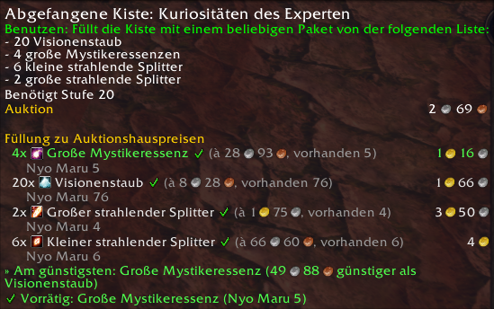
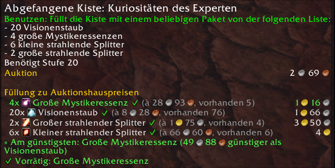
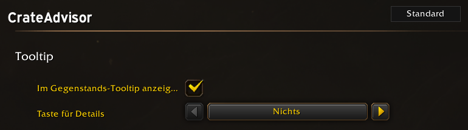

# CrateAdvisor

Which package should go into a **Waylaid Crate** (*Abgefangene Kiste*)? CrateAdvisor lists in the
crate's tooltip what each material package costs at the auction house, names the cheapest one and
shows which materials you already own on any of your characters. For World of Warcraft Forever
(Interface 16001).

For each package of the crate:

- **amount and total price**, cheapest first (Auctionator's latest scan; no auction house cut, since
  you buy), the cheapest in green
- **unit price**, with an age note when the price is 3 or more days old (or over 3 weeks)
- **how many you already own**, ✓ when that is enough for the package, and below it where it lies
  (up to 3 characters or banks)
- packages without a price come last; the recommendation then says `prices missing`

Below the packages:

- **» Am günstigsten** (Cheapest): the cheapest package and how much it saves over the next one
- **✓ Vorrätig** (In stock): the cheapest package you could fill from what you already own, and
  where it lies

The screenshots are from the German client; the addon is in English and German.

## Installation

1. Download `CrateAdvisor-<version>.zip` from the
   [latest release](https://github.com/NyoCon/CrateAdvisor/releases/latest).
2. Unpack it into `World of Warcraft/_forever_/Interface/AddOns/`, so that you get
   `AddOns/CrateAdvisor/CrateAdvisor.toc`.
3. `/reload` or restart the game, then hover over a crate.

(*Code > Download ZIP* works too, but unpacks to `CrateAdvisor-main`: rename the folder to
`CrateAdvisor`.)

Both helpers are optional:

- [Auctionator](https://www.curseforge.com/wow/addons/auctionator) for the prices. Without it the
  tooltip lists the packages without prices.
- [Syndicator](https://www.curseforge.com/wow/addons/syndicator) for the stock of all your
  characters of the connected realm and faction (bags, bank, mail), guild banks and the warband
  bank. Without it only the current character's bags and bank count, and the places are not shown:

Equipped items and running auctions do not count as stock.

## Settings

*Esc > Options > AddOns > CrateAdvisor*, or `/cadv`:

| Setting | Default | |
|---|---|---|
| Show in item tooltips | on | |
| Modifier key for details | None | None, Ctrl, Shift or Alt. With a key, unit prices, price age, owned amounts and where they lie are only shown while it is held; packages, totals, the recommendation and `Vorrätig` stay visible |

## Chat commands

| Command | Effect |
|---|---|
| `/cadv` | opens the settings |
| `/cadv status` | status and help (also shows the last tooltip error, if any) |
| `/cadv details none\|ctrl\|shift\|alt` | details always (default) or only while that key is held |
| `/cadv on\|off` | tooltip lines on or off |

## How it works

The client does not know the packages as item IDs: a crate's use spell has one dummy effect per
package whose base points are the amount, and its description names the material
(`- $M3 Bolt of Mageweave`). `tools/update_data.py` reads the Forever client tables (Spell,
SpellEffect, ItemEffect, ItemXItemEffect, ItemSparse) from wago.tools, resolves the English names
to item IDs and writes `Data/Crates.lua`. Rerun it when Forever adds or changes crates:

    python3 tools/update_data.py [build]

## Development

`luajit dev/run.lua` loads the addon with a small mock of the WoW API and prints the tooltip lines
of a few crates as text (`LOCALE=enUS`, `NO_AUCTIONATOR=1`, `NO_SYNDICATOR=1` for variants).

## License

MIT, see `LICENSE`.
